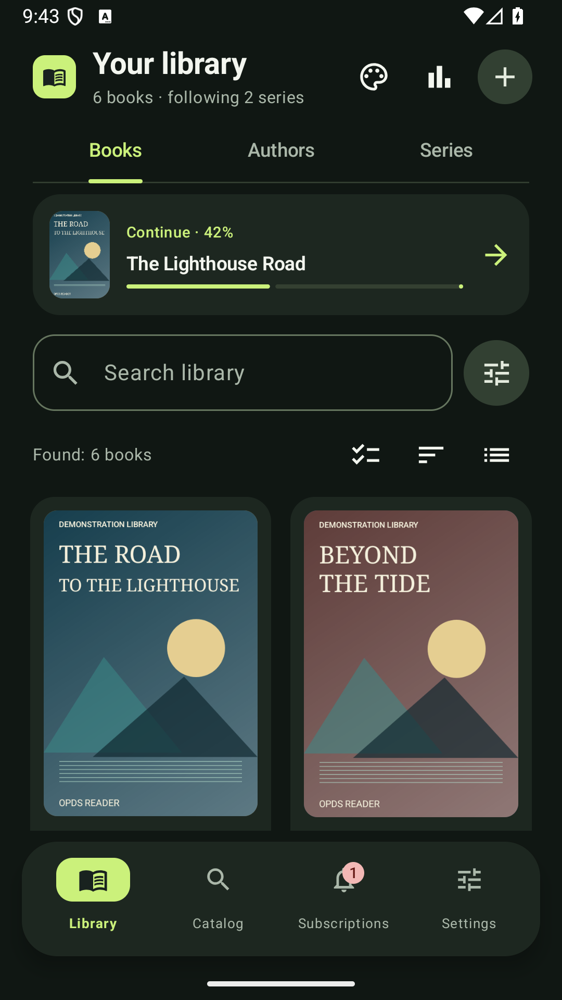
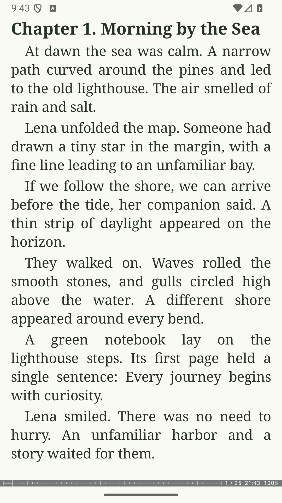
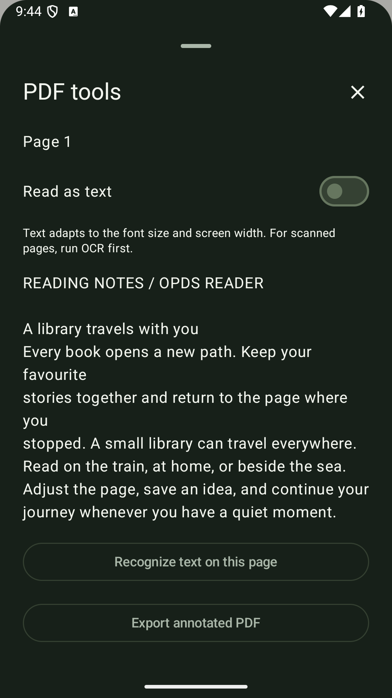
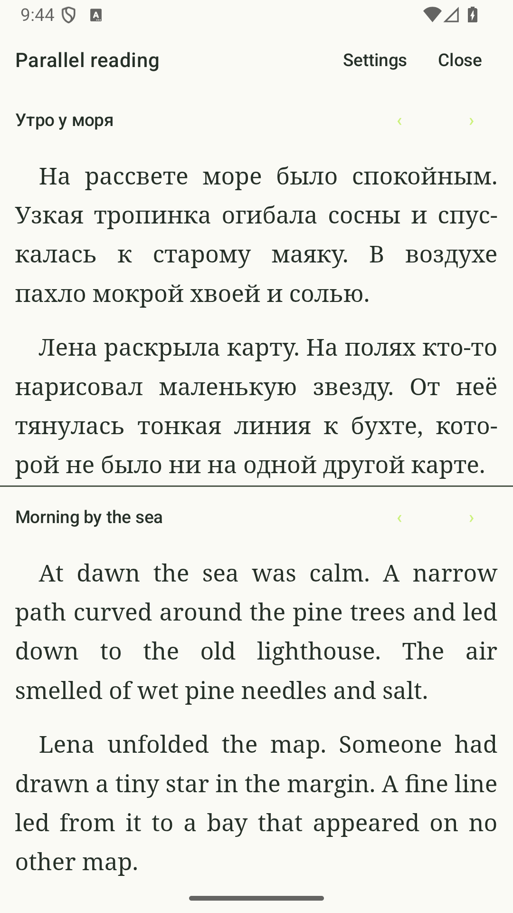
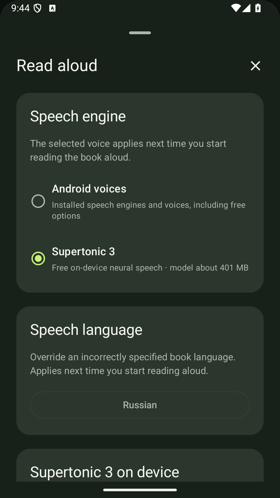
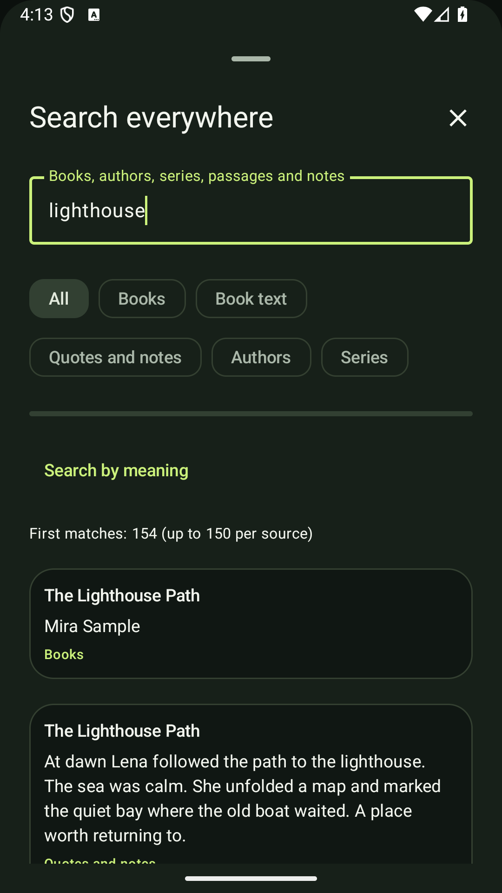
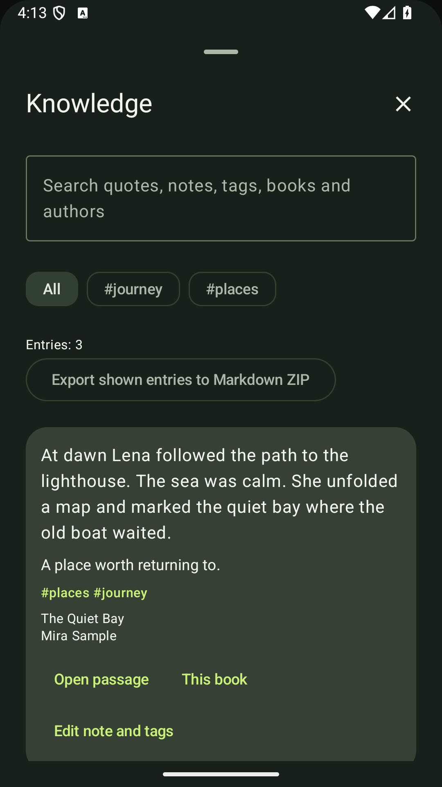
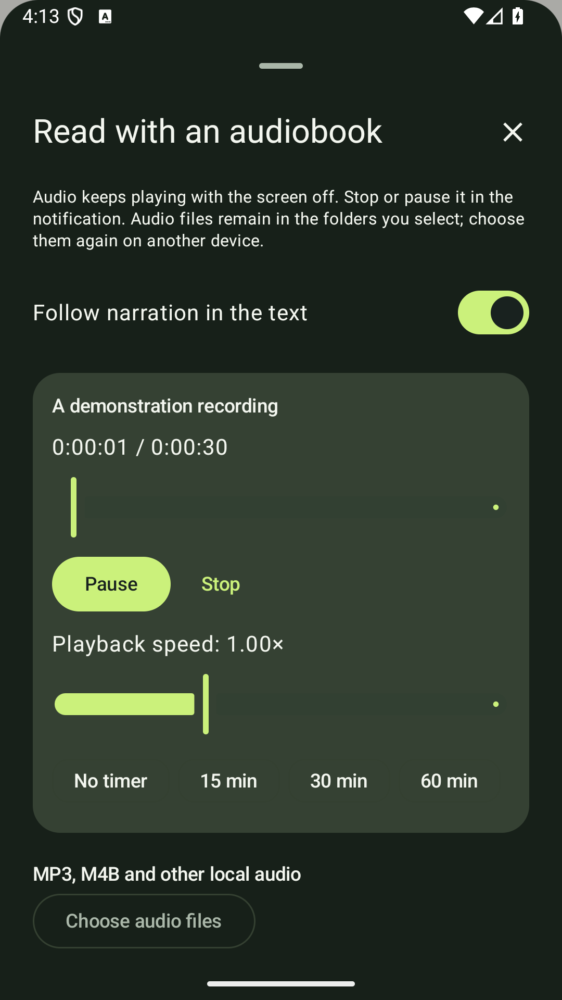

# OPDS Reader

[Русский](README.md) · [Download](https://github.com/Grimsel1/opds-reader/releases/tag/v0.5.42-en) · [Privacy Policy](https://grimsel1.github.io/opds-reader-privacy/privacy-en.html)

An Android reader with a personal library, adjustable page layout and text-to-speech. Open your local files, connect your own OPDS catalogs and follow new releases from favorite authors and series.

**Android 8.0+ · English and Russian · Free, with no built-in ads or purchases**

## Features

### Library and search

- Books, Authors and Series views, covers, descriptions, favorites, collections, filters, sorting, grid and list layouts.
- Series order by part number and matching of local files with catalog records to merge duplicates.
- File import and user-selected folder scanning through Android's system picker. Choose a download folder and reconnect moved books while keeping notes.
- Unified search across titles, authors, series, book text, quotes, bookmarks and notes, with links to the original passage.
- Build the local full-text index when you choose. Optional semantic search uses a compatible provider and an embedding model.
- Import available **ReadEra, Moon+, KOReader and FBReader** exports with previews, book matching and duplicate protection. Position transfer depends on the export; FBReader supports text bookmarks and quotes.
- Reading status, history, statistics, last-book startup and a library widget. Automatically mark finished books, or turn this option off.

### Catalogs and downloads

- Add your own **OPDS catalogs**, search books, authors and series, and download individual books or available series entries.
- Sign in to sources that use a supported authentication method. Personal shelves and account access depend on the catalog.
- Favorite authors and series, new-release subscriptions, manual checks and scheduled background checks, with known entries matched to the library.
- Transfer books from **Calibre over Wi-Fi through a TLS gateway** and read adjacent Calibre metadata.
- No books or online catalogs are preinstalled; users choose their sources.

### Reading and controls

- Pages or scrolling, page-turn effects, contents, in-book search, footnotes and a page thumbnail map.
- Illustrations, tables, EPUB/FB2 publisher styles and fixed-layout EPUB3. Scripts from books are disabled.
- Multiple app and page themes, custom fonts and backgrounds, font size, spacing, margins, hyphenation and columns.
- Reading profiles, per-book preferences, scheduled themes, headers and footers.
- Fullscreen reading, orientation lock, brightness gestures with a percentage indicator and extra dimming.
- Custom tap zones, gestures, volume keys, keyboard, mouse and reading toolbar buttons.
- E-Ink contrast, grayscale, reduced animation and refresh preferences. Hardware refresh depends on the device and the system API it provides.

### PDF, DjVu and comics

- PDF Fit width, Fill screen and Fit page modes, pinch zoom and panning.
- Password-protected PDFs, crop, deskew, column reading order and text-layer tools.
- Offline Russian/English OCR after the required language data is prepared.
- Handwritten annotations and PDF export.
- Supported **AcroForm** text fields, checkboxes, radio buttons and lists, with preview, saved drafts and a separate editable output copy.
- DjVu and CBZ/CBR viewing, including RAR and RAR5 archives.

### Quotes, notes and study

- Bookmarks, highlights, quotes and notes, editing and links back to the source.
- A shared knowledge center with search, tags, book filters and Markdown export.
- Annotation import and export.
- Study cards from excerpts, decks, spaced repetition and **Anki TSV** export.
- Offline **StarDict** dictionaries, external dictionaries and Russian/English word-form lookup after optional dictionary data downloads.

### Translation and reading assistance

- Selection and book translation, **DeepL** with your own key and compatible custom providers.
- Parallel reading of an original and translation, manual links, automatic alignment and a result preview.
- Configure a compatible AI provider with your HTTPS endpoint, model, key and optional embedding model. Connect **Ollama / LM Studio** through a secure TLS gateway.
- Passage explanations, semantic search across selected books, questions about read excerpts, recaps and a character/event guide linked to quotations.
- Sending text to an external provider requires consent. Quality depends on the model; a quotation does not rule out errors or spoilers.

### Speech and audiobooks

- Installed Android voices and local **Supertonic 3** and Russian **Silero** narration after a separate model download, with word-stress processing for Silero.
- Speed, volume, a sleep timer, book queue, pronunciation rules, dialogue voices and audio-focus preferences.
- Background playback, system media controls and synthesized speech export to WAV.
- Pair **MP3/M4B** audiobooks with text using chapter time links and saved positions.
- Exact fragment highlighting for EPUBs with publisher-supplied **SMIL timing**. Open embedded EPUB audio and video separately.

### Backup and integrations

- Local backups and optional **Mail.ru Cloud** synchronization.
- Data categories, reading-position history and conflict resolution, notes, statistics, a speech queue and separate selection of book files.
- Optional **Readwise, Notion and Joplin** connections.
- **Hardcover** edition matching, manual status/progress updates, ratings and reviews, using your account and key.
- **StoryGraph CSV** exchange with a matching preview; this is file exchange rather than direct account synchronization.

### Formats and requirements

**EPUB, FB2, TXT, HTML, MOBI, AZW, AZW3, DOCX, RTF, PDF, DjVu, CBZ and CBR.**

Core reading works offline. Additional voices, OCR and dictionary data may need an initial download. Catalogs, cloud sync, translation and external integrations require a network and may require a separate account or personal key. External providers set their own terms and prices.

DRM-protected books are not supported. Individual features depend on the document format and structure, selected engine and device.

## Screenshots

 

 

 

 

## Install

Open the [latest release](https://github.com/Grimsel1/opds-reader/releases/tag/v0.5.42-en), download **OPDS-Reader-0.5.42.apk**, open the file and follow the Android prompts. `SHA256SUMS.txt` is provided beside the APK for download integrity checks.

## Feedback and terms

Report issues through [Issues](https://github.com/Grimsel1/opds-reader/issues), including the app version, device, Android version, book format and reproduction steps.

Developer: **@Grimsel** · [Stolstoluckii@gmail.com](mailto:Stolstoluckii@gmail.com)

The app is distributed under the [usage license](LICENSE). The proprietary application source is not published. Third-party notices are available in the app.
