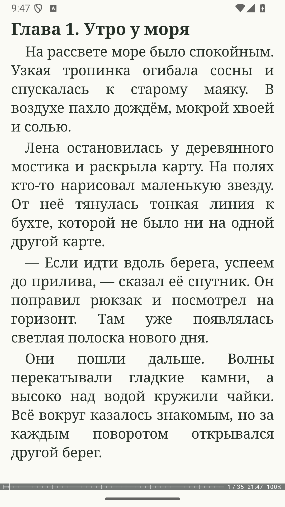
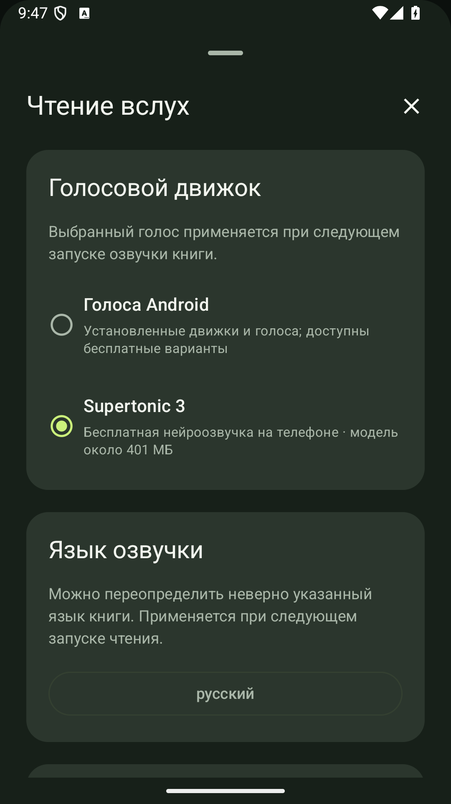

# OPDS Reader

[English](README.en.md) · [Скачать приложение](https://github.com/Grimsel1/opds-reader/releases/latest) · [Политика конфиденциальности](https://grimsel1.github.io/opds-reader-privacy/privacy-ru.html)

Читалка для Android с собственной библиотекой, гибким оформлением страницы и озвучиванием книг. Открывайте файлы с устройства, подключайте свои OPDS-каталоги и следите за продолжениями любимых серий.

**Android 8.0 и новее · Русский и английский интерфейс · Бесплатно, без встроенной рекламы и покупок**

## Возможности

- EPUB, FB2, PDF, DjVu, TXT, HTML, MOBI/AZW/AZW3, DOCX, RTF и комиксы CBZ/CBR.
- Библиотека с обложками, авторами, сериями, коллекциями и статусами чтения. Поиск книг в выбранных папках устройства.
- Свои OPDS-каталоги: поиск, загрузка книг и подписки на авторов и серии. Предустановленных онлайн-каталогов нет.
- Шрифты, темы, поля, интервалы, постраничное чтение, прокрутка и настройка управления.
- Закладки, цитаты, заметки, единый поиск и центр сохранённых материалов.
- PDF с масштабированием и перемещением страницы, распознаванием текста и заполнением поддерживаемых форм.
- Чтение вслух системными голосами и локальная нейроозвучка после загрузки модели. Таймер сна и настройки произношения.
- Параллельное чтение, перевод, аудиокниги и привязка аудио к тексту.
- Учебные карточки, повторение и экспорт для Anki.
- Резервные копии и необязательная синхронизация через Облако Mail.ru.

Основное чтение работает без интернета. Подключаемые сервисы, перевод и дополнительные модели могут требовать интернет, отдельную учётную запись или личный ключ. Тарифы внешних сервисов устанавливают их владельцы. Книги с DRM не поддерживаются; точность отображения зависит от структуры документа.

## Скриншоты

 

 

## Установка

1. Откройте [последний выпуск](https://github.com/Grimsel1/opds-reader/releases/latest).
2. Скачайте файл **OPDS-Reader-0.5.41.apk**.
3. Откройте скачанный файл и следуйте подсказкам Android.

Рядом с APK опубликован файл `SHA256SUMS.txt` для проверки целостности загрузки. В этом репозитории находятся установочные выпуски и материалы приложения.

## Обратная связь

Об ошибке можно сообщить в [Issues](https://github.com/Grimsel1/opds-reader/issues). Укажите версию приложения, модель устройства, версию Android, формат книги и шаги повторения.

Разработчик: **@Grimsel** · [Stolstoluckii@gmail.com](mailto:Stolstoluckii@gmail.com)

## Условия использования

Приложение распространяется по [лицензии на использование](LICENSE). Собственный исходный код приложения не публикуется. Права и лицензии сторонних компонентов доступны в приложении, в разделе «О программе».
