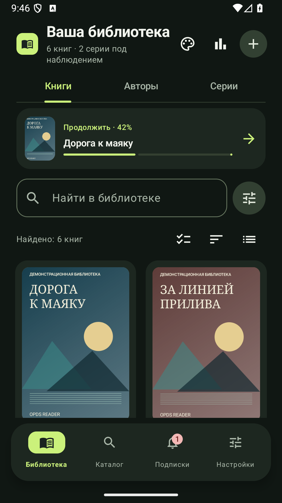
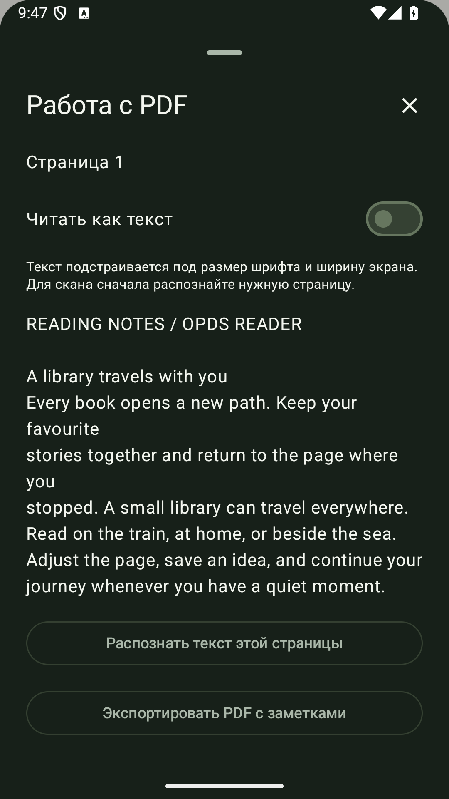
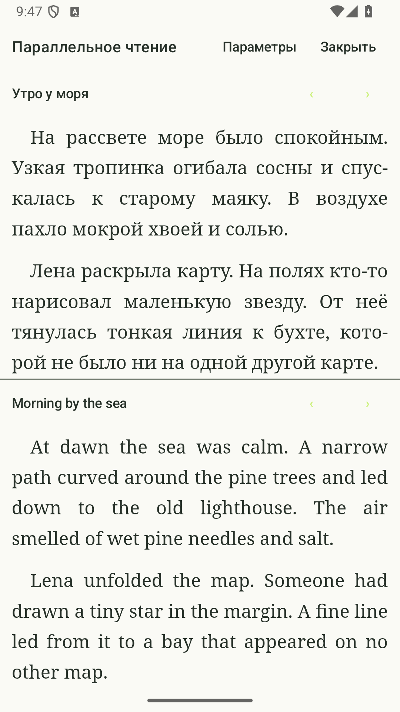
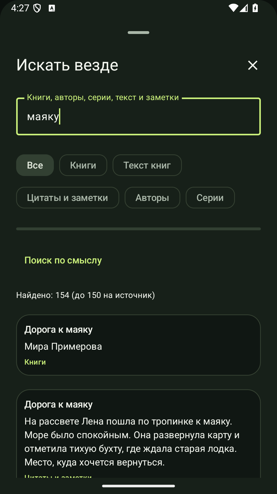
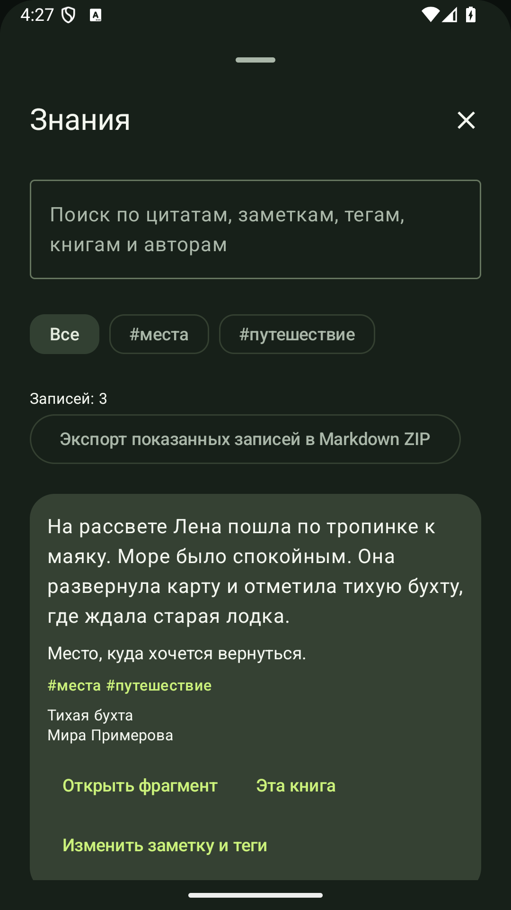
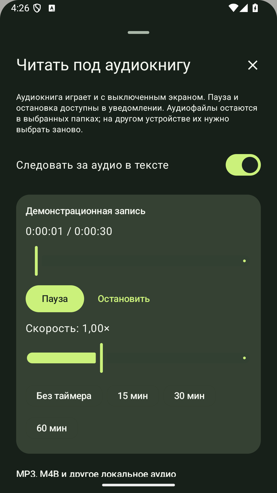

# OPDS Reader

[English](README.en.md) · [Скачать приложение](https://github.com/Grimsel1/opds-reader/releases/tag/v0.5.42) · [Политика конфиденциальности](https://grimsel1.github.io/opds-reader-privacy/privacy-ru.html)

Читалка для Android с собственной библиотекой, гибким оформлением страницы и озвучиванием книг. Открывайте файлы с устройства, подключайте свои OPDS-каталоги и следите за продолжениями любимых серий.

**Android 8.0 и новее · Русский и английский интерфейс · Бесплатно, без встроенной рекламы и покупок**

## Возможности

### Библиотека и поиск

- Вкладки «Книги», «Авторы» и «Серии», обложки и описания, избранное, коллекции, фильтры, сортировка и сетка или список.
- Порядок книг в серии по номеру части; сопоставление локальных файлов и записей каталога с объединением совпадений.
- Импорт файлов и сканирование выбранных папок через системный выбор Android. Выбор папки загрузки и восстановление связи с перемещённым файлом без потери заметок.
- Единый поиск по названиям, авторам, сериям, текстам книг, цитатам, закладкам и заметкам с переходом к исходному месту.
- Локальный полнотекстовый индекс создаётся по вашей команде. Смысловой поиск подключается отдельно через совместимого провайдера и модель embeddings.
- Перенос доступных экспортов **ReadEra, Moon+, KOReader и FBReader**: предпросмотр, сопоставление книг и защита от дублей. Перенос позиций зависит от формата; из FBReader поддерживаются текстовые закладки и цитаты.
- Статусы чтения, история, статистика, продолжение последней книги и виджет. Автоматическая отметка дочитанной книги с возможностью отключения.

### Каталоги и загрузки

- Подключение собственных **OPDS-каталогов**, поиск книг, авторов и серий, загрузка отдельных книг и доступных книг серии.
- Вход в источники с поддерживаемым способом авторизации. Возможности личной полки и доступа зависят от конкретного каталога.
- Избранные авторы и серии, подписки на новинки, ручные и периодические фоновые проверки. Уже известные записи сопоставляются с библиотекой.
- Передача книг из **Calibre по Wi-Fi через TLS-переходник**, чтение соседних метаданных Calibre.
- Книги и онлайн-каталоги не предустановлены: источники выбирает пользователь.

### Чтение и управление

- Постраничное чтение и прокрутка, эффекты перелистывания, оглавление, поиск в книге, сноски и карта миниатюр страниц.
- Иллюстрации, таблицы, издательские стили EPUB/FB2 и EPUB3 с фиксированной вёрсткой. Скрипты из книги не выполняются.
- Несколько тем приложения и страницы, свои шрифты и фоны, размер текста, интервалы, поля, переносы и колонки.
- Профили чтения и отдельные настройки книги, темы по расписанию, верхняя и нижняя информационные строки.
- Полноэкранный режим, фиксация поворота, яркость жестом с процентами и дополнительное затемнение.
- Настраиваемые зоны касания, жесты, кнопки громкости, клавиатура, мышь и кнопки панели чтения.
- Параметры E-Ink: контраст, оттенки серого, сокращение анимаций и обновление экрана. Аппаратное обновление зависит от устройства и доступного системного API.

### PDF, DjVu и комиксы

- Масштаб PDF «По ширине», «Заполнить экран» и «Страница целиком», увеличение двумя пальцами и перемещение увеличенной страницы.
- PDF с паролем, обрезка полей, выравнивание наклона, порядок чтения колонок и работа с текстовым слоем.
- Офлайн-OCR на русском и английском после подготовки необходимых языковых данных.
- Рукописные пометки и экспорт PDF.
- Заполнение поддерживаемых **AcroForm**: текст, флажки, переключатели и списки; предпросмотр, черновик и сохранение отдельной редактируемой копии.
- Просмотр DjVu и комиксов CBZ/CBR; поддержка архивов RAR и RAR5.

### Цитаты, заметки и обучение

- Закладки, выделения, цитаты и заметки; редактирование и переход обратно к фрагменту.
- Общий центр сохранённых материалов: поиск, теги, фильтры по книгам и экспорт Markdown.
- Импорт и экспорт аннотаций.
- Учебные карточки из фрагментов, колоды, интервальные повторения и экспорт **Anki TSV**.
- Офлайн-словари **StarDict**, внешние словари и поиск словоформ русского и английского после загрузки дополнительных словарных данных.

### Перевод и помощь при чтении

- Перевод выделенного фрагмента и книги, **DeepL** с вашим ключом и совместимые пользовательские провайдеры.
- Параллельное чтение оригинала и перевода: ручные связи, автоматическое сопоставление и предпросмотр результата.
- Настройка совместимого AI-сервиса: собственный HTTPS-адрес, модель, ключ и при необходимости модель embeddings. **Ollama / LM Studio** подключаются через защищённый TLS-переходник.
- Объяснение фрагмента, смысловой поиск по выбранным книгам, вопросы по прочитанному, краткий обзор и справочник персонажей и событий с цитатами из текста.
- Передача текста внешнему провайдеру требует согласия. Качество зависит от модели; наличие цитаты не исключает ошибку или спойлер.

### Озвучивание и аудиокниги

- Установленные голоса Android и локальная нейроозвучка **Supertonic 3** и русская **Silero** после отдельной загрузки модели. Для Silero предусмотрена расстановка ударений.
- Скорость и громкость, таймер сна, очередь книг, правила произношения, голоса диалогов и реакция на звук других приложений.
- Фоновое воспроизведение, системная панель управления и экспорт синтезированной речи в WAV.
- Аудиокниги **MP3/M4B** рядом с текстом: привязка времени к главам и сохранение позиции.
- Точная подсветка фрагментов для EPUB с готовой **SMIL-разметкой**. Встроенные в EPUB аудио и видео открываются отдельно.

### Сохранение и интеграции

- Локальные резервные копии и необязательная синхронизация через **Облако Mail.ru**.
- Выбор категорий данных, история и разрешение конфликтов позиций, заметки, статистика, очередь озвучки и отдельный выбор файлов книг.
- Подключение **Readwise, Notion и Joplin** по желанию.
- **Hardcover**: сопоставление изданий, ручная передача статуса и прогресса, оценки и отзывы. Для отправки нужны ваш аккаунт и ключ.
- Обмен CSV со **StoryGraph** с предварительным сопоставлением книг; это файловый обмен, а не прямая синхронизация аккаунта.

### Форматы и условия

**EPUB, FB2, TXT, HTML, MOBI, AZW, AZW3, DOCX, RTF, PDF, DjVu, CBZ и CBR.**

Основное чтение работает без интернета. Дополнительные голоса, OCR и словарные данные могут требовать первоначальной загрузки. Каталоги, облачная синхронизация, перевод и внешние интеграции требуют сети и, в зависимости от сервиса, отдельного аккаунта или личного ключа. Тарифы внешних сервисов устанавливают их владельцы.

DRM-защищённые книги не поддерживаются. Доступность отдельных функций зависит от формата и структуры книги, выбранного движка и устройства.

## Скриншоты

 

 

 

 

## Установка

1. Откройте [последний выпуск](https://github.com/Grimsel1/opds-reader/releases/tag/v0.5.42).
2. Скачайте файл **OPDS-Reader-0.5.42.apk**.
3. Откройте скачанный файл и следуйте подсказкам Android.

Рядом с APK опубликован файл `SHA256SUMS.txt` для проверки целостности загрузки. В этом репозитории находятся установочные выпуски и материалы приложения.

## Обратная связь

Об ошибке можно сообщить в [Issues](https://github.com/Grimsel1/opds-reader/issues). Укажите версию приложения, модель устройства, версию Android, формат книги и шаги повторения.

Разработчик: **@Grimsel** · [Stolstoluckii@gmail.com](mailto:Stolstoluckii@gmail.com)

## Условия использования

Приложение распространяется по [лицензии на использование](LICENSE). Собственный исходный код приложения не публикуется. Права и лицензии сторонних компонентов доступны в приложении, в разделе «О программе».
